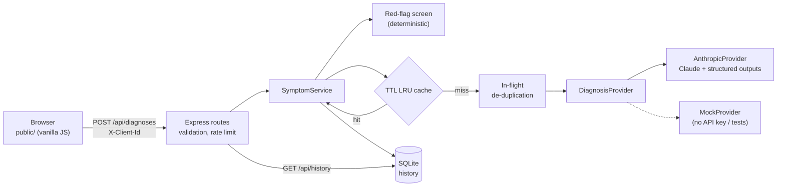

# HealthAI Symptom Checker

A web app where patients describe their symptoms in plain language and get back a structured, AI-generated list of potential conditions, an urgency level, and next steps. Built for HealthAI, a fictional health-tech startup.

> HealthAI gives general information. It is not medical advice and does not make a diagnosis. The app says this on every page.

## Quick start

Requires **Node.js 22.18 or newer**. The server runs TypeScript directly through Node's built-in type stripping, so there is no build step, and history is stored with the built-in `node:sqlite` module, so there are no native modules to compile.

```bash
npm install
cp .env.example .env      # optional: add ANTHROPIC_API_KEY
npm start                 # http://localhost:3000
```

- **With an `ANTHROPIC_API_KEY`**, analysis uses Claude (`claude-opus-5-5` by default).
- **Without a key**, the app starts in **demo mode** with an offline keyword-based mock model. A banner in the UI says so. The mock waits 1.5 s on purpose, so the cache speed-up is still easy to see.

Other commands:

```bash
npm run dev         # restart on file changes
npm test            # 36 tests (node:test + supertest), no network needed
npm run typecheck   # tsc --noEmit
npm run check       # typecheck + tests
```

All settings are listed in [`.env.example`](.env.example). They are validated at startup, and the server refuses to start with a clear message if one is invalid.

## How each requirement is met

| Requirement | Where | How to see it |
|---|---|---|
| **Must:** symptom input UI | [`public/index.html`](public/index.html), [`public/app.js`](public/app.js) | Type symptoms and press *Check symptoms*. Age and sex are optional. |
| **Must:** LLM returns potential diagnoses | [`src/llm/anthropicProvider.ts`](src/llm/anthropicProvider.ts) | Results show 2–5 conditions, each with a likelihood, an explanation and a next step, plus an urgency level. |
| **Must:** validation (not empty, min length) | [`src/domain/schemas.ts`](src/domain/schemas.ts) (server), `validateSymptoms` in `app.js` (client) | Submitting an empty field shows *"Please describe your symptoms."* Text that is under 10 characters, over 1000 characters, or has no words is also rejected. |
| **Should:** history | [`src/history/historyRepository.ts`](src/history/historyRepository.ts), the *History* tab | Every check is saved. Click an entry to expand the full result. *Clear history* deletes them all. |
| **Should:** caching | [`src/cache/`](src/cache), [`src/services/symptomService.ts`](src/services/symptomService.ts) | Submit the same symptoms twice. The second result shows *"⚡ From cache in <1 ms"*. `GET /api/cache/stats` shows hit and miss counts. |
| **Must:** architecture and trade-offs documented | This README | See below. |
| **Could:** responsive | [`public/styles.css`](public/styles.css) | Checked at 375 px wide with no horizontal scroll. Supports dark mode and reduced motion. |

## Architecture



What happens on one request (`POST /api/diagnoses`):

1. **Validate.** A Zod schema trims the input and checks its length and content. Invalid input gets a `400` with a message the patient can read, and the model is never called.
2. **Red-flag screen.** Regular expressions look for emergency phrases such as chest pain, stroke signs or self-harm. This does not depend on the LLM, so the emergency warning still shows if the model is slow, down or wrong.
3. **Cache lookup.** The key is a SHA-256 of `(model, prompt version, normalised symptoms, age, sex)`. A hit skips the model entirely.
4. **LLM call (on a miss).** If an identical request is already running, the new one waits for it instead of starting a second call. Claude returns JSON that must match `AnalysisSchema`.
5. **Persist and respond.** The result is saved to history under the browser's anonymous client id and returned with `meta.cached` and `meta.latencyMs`.

### Layout

```
src/
  server.ts                 entry point: load config, listen, graceful shutdown
  app.ts                    composition root (wires dependencies; tests inject fakes)
  config.ts                 env parsing + validation
  errors.ts                 AppError hierarchy -> HTTP status + stable error codes
  domain/schemas.ts         input + LLM output schemas (single source of truth)
  domain/redFlags.ts        deterministic emergency screen
  llm/provider.ts           DiagnosisProvider interface
  llm/anthropicProvider.ts  Claude integration + SDK error mapping
  llm/mockProvider.ts       offline stand-in
  llm/prompt.ts             system prompt + PROMPT_VERSION
  cache/                    TTL LRU cache + key normalisation
  history/                  SQLite repository
  services/symptomService.ts orchestration
  http/                     routes + error middleware
public/                     static UI (HTML/CSS/JS, no build)
test/                       unit + HTTP tests
```

### API

All errors use one shape: `{ "error": { "code", "message", "details?" } }`. Every endpoint except `/health` and `/cache/stats` needs an `X-Client-Id: <uuid>` header.

| Method | Path | Notes |
|---|---|---|
| `POST` | `/api/diagnoses` | Body `{ symptoms, age?, sex? }` → `201` with the full record. Rate-limited to 20 requests/min per IP. |
| `GET` | `/api/history?limit=50` | Newest first, only this client's entries |
| `GET` | `/api/history/:id` | `404` if the entry belongs to another client |
| `DELETE` | `/api/history` | Deletes this client's history |
| `GET` | `/api/health` | Model in use and `anthropic` / `mock` mode |
| `GET` | `/api/cache/stats` | `size`, `hits`, `misses` |

## Key decisions and trade-offs

### Choosing the LLM

- **Claude Opus 5.5 (`claude-opus-5-5`) at `effort: "medium"`.** Medical triage is a case where a missed serious condition costs far more than a little extra latency or money, so I chose the most capable general model. Effort is the main cost/latency setting. `medium` is the model's default and gives careful answers in a few seconds. Model and effort are both environment variables, so a cheaper or faster setup (for example `claude-haiku-5-5`, or `effort=low`) can be tried without code changes. The cache keeps the cost of repeated queries low.
- **Structured outputs, not free text.** The response is limited to a JSON schema generated from the Zod `AnalysisSchema`. The UI can rely on fields like `urgency` and `conditions[]` instead of parsing prose. If the output still fails validation, the patient gets a clean `502` instead of a broken page.
- **"Not symptoms" is part of the schema.** The model sets `recognizedAsSymptoms: false` for input like a poem request or a test string, and the API turns that into a `422` with guidance. Length rules alone can't catch this.
- **Prompt-injection stance.** Patient text goes inside `<symptoms>` tags, and the system prompt tells the model to treat it as data. The output schema also limits what an injected instruction could produce.
- **Refusal fallback.** Requests go out with `fallbacks: "default"`, so if a safety classifier declines, the API retries on a fallback model by itself. A refusal that remains is reported as a normal error, not a crash.
- **A provider interface with a mock.** `SymptomService` depends on `DiagnosisProvider`, not on the SDK. This lets the app run with no key, keeps tests fast and offline, and means a different vendor would only need one new class. The cost is a mock that is much simpler than the real model, so it is only for demos and tests.
- **No streaming.** The response is a single JSON object, so streaming partial JSON would add complexity without helping the patient. A spinner plus a 90 s client timeout covers the wait.

### Caching strategy

- **An in-process TTL + LRU cache** (a `Map`, O(1) operations, 500 entries and a 1 h TTL by default). It needs no infrastructure and makes repeat lookups take under 1 ms. **The trade-off:** the cache is per process and is lost on restart. With several instances behind a load balancer, I would put it in Redis behind the same `get`/`set` interface.
- **Exact match after normalisation, not semantic matching.** The key ignores case, punctuation and extra whitespace, so `"Headache, FEVER!"` and `"headache fever"` share an entry. Word order is kept, because reordering can change the meaning. An embedding-based "similar symptoms" cache would get more hits, but it could hand one patient a result meant for a slightly different description. In a medical setting that is the wrong failure, so I accepted a lower hit rate for correctness.
- **What goes into the key.** Age and sex are included because they change the answer. The model ID and `PROMPT_VERSION` are included so that changing either one never serves results from the old setup.
- **What gets cached.** Successful analyses are cached, including "not symptoms" verdicts, so repeated junk input doesn't cost a model call each time. Errors are never cached, so a temporary outage doesn't stick.
- **Stampede protection.** If the same query arrives while it is already running, both requests share one LLM call.
- **Freshness.** The 1 h TTL bounds how stale a result can get, for example after a prompt or model update that didn't bump `PROMPT_VERSION`.

### History and privacy

- **No accounts.** Each browser generates a random UUID, keeps it in `localStorage` and sends it as `X-Client-Id`. Every history query is filtered by that id. This meets the requirement without collecting identity, but it is not authentication: anyone holding the UUID can read that history. A production version would use real authentication and encryption at rest, and would need a review against health-data rules such as HIPAA and GDPR.
- **SQLite through `node:sqlite`.** Data survives restarts, needs no native build, and can be queried with SQL. It is fine for a single instance. Postgres would be the next step.
- **Patients control their data.** *Clear history* deletes all of a browser's entries. Symptom text is never written to logs.

### Error handling

| Situation | Status | What the patient sees |
|---|---|---|
| Empty, too short or too long input, malformed JSON | 400 | A specific message under the field |
| Input that isn't symptoms | 422 | *"We couldn't identify any symptoms…"* with an example |
| Too many requests | 429 | *"Please wait a minute"* |
| Claude rate-limited, overloaded or unreachable | 503 / 504 | *"Busy, try again."* The SDK already retries twice with backoff. |
| Bad API key, refusal, truncated or invalid output | 502 | A generic message. Details go to the server log only. |
| Anything unexpected | 500 | A generic message. Internal details are never returned. |

If the model fails but the red-flag screen matched, the error response still carries `details.redFlags`, and the UI shows the emergency warning.

### Front end

Plain HTML, CSS and JavaScript (an ES module), with no framework and no build step. The UI is two views, so a framework would add more tooling than value. All text from the patient or the model is inserted with `textContent`, never `innerHTML`, to prevent XSS. `helmet` sets a strict Content-Security-Policy.

## Testing

`npm test` runs 36 tests in about 1.5 s, all offline:

- **Validation:** empty input, whitespace only, minimum and maximum length, no words, optional fields.
- **Cache:** TTL expiry (with an injected clock), LRU eviction, key normalisation, key separation by model and prompt version.
- **Service:** cache hits skip the model and come back faster, concurrent requests are merged, failures are not cached, red flags survive an outage, non-symptom input is rejected.
- **Claude provider:** request shape (model, effort, JSON-schema format), refusal, `max_tokens` and parse-failure handling, and mapping of every SDK error class to an HTTP status.
- **HTTP:** end-to-end through Express with an in-memory database. This covers each acceptance criterion, history scoping between clients, and that internal error details never leak.

## Limitations and next steps

- I did not run an automated evaluation against a set of clinical vignettes. Before real use, I would build one (for example, checking that serious conditions are never missed) and use it to tune the prompt and effort level.
- The red-flag list is English only and keyword based. It is a safety net, not a classifier.
- Single instance only: the cache is in memory and the database is SQLite (see the trade-offs above for how to scale).
- No authentication (see *History and privacy*).

## AI usage

**Tools:** Claude Code (Anthropic's coding agent, running Claude Opus 5.5) in the Claude desktop app.

**What it touched:**
- Scaffolding the project and choosing the stack (Express, Zod, `node:sqlite`, no front-end build).
- First drafts of all source files, tests, CSS and this README.
- Finding the right Anthropic SDK calls (`beta.messages.parse`, `betaZodOutputFormat`, `fallbacks`) from the SDK's bundled documentation and type definitions.

**What was verified or changed afterwards:**
- `tsc` passes in strict mode, and all 36 tests pass.
- The UI was used in a real browser: empty submission, a valid submission, a repeat submission served from cache (1.5 s → <1 ms), the history page, and the emergency banner. It was also checked at a 375 px mobile width (no horizontal scroll).
- Bugs found and fixed during that review:
  - The loading spinner showed while it was supposed to be hidden, because CSS `display:flex` overrode the `hidden` attribute.
  - Mock results were not sorted by likelihood.
  - Labels were over-capitalised ("Moderate Likelihood").
  - When the model's JSON failed schema validation, the API returned a 500 instead of a 502.
- **Not verified:** the Claude integration was only tested against a stubbed SDK client, because no API key was available during development. The first run with a real key should be checked by hand.
- _TODO (author): add your own review notes here, e.g. what you read line by line, what you changed, and what you tested with a real API key._
