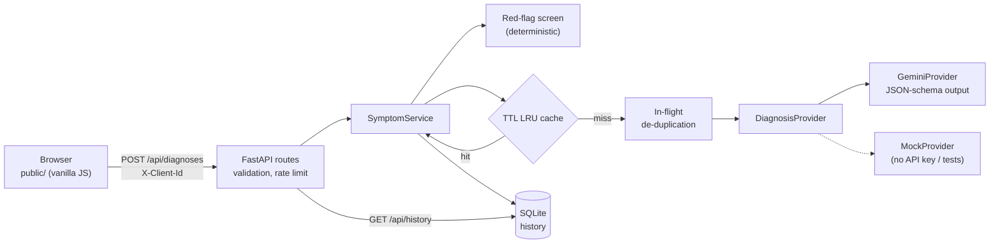

# HealthAI Symptom Checker

A web app where patients describe their symptoms in plain language and get back a structured, AI-generated list of potential conditions, an urgency level, and next steps. Built for HealthAI, a fictional health-tech startup.

> HealthAI gives general information. It is not medical advice and does not make a diagnosis. The app says this on every page.

**Stack:** Python 3.11+ · FastAPI · Google Gemini (`google-genai` SDK) · SQLite · plain HTML/CSS/JS front end (no build step).

## Quick start

```bash
python3 -m venv .venv
source .venv/bin/activate
pip install -r requirements-dev.txt
cp .env.example .env          # then add your GEMINI_API_KEY
python -m app                 # http://localhost:8000
```

- **With a `GEMINI_API_KEY`**, analysis uses Google Gemini. You can get a free key at https://aistudio.google.com/apikey.
- **Without a key**, the app starts in **demo mode** with an offline keyword-based mock model. A banner in the UI says so. The mock waits 1.5 s on purpose, so the cache speed-up is still easy to see.

Other commands:

```bash
pytest              # 48 tests, no network needed
ruff check .        # lint
mypy                # strict type check
```

All settings are listed in [`.env.example`](.env.example). They are validated at startup, and the server refuses to start with a clear message if one is invalid. Interactive API docs are served at `/api/docs`.

## How each requirement is met

| Requirement | Where | How to see it |
|---|---|---|
| **Must:** symptom input UI | [`public/index.html`](public/index.html), [`public/app.js`](public/app.js) | Type symptoms and press *Check symptoms*. Age and sex are optional. |
| **Must:** LLM returns potential diagnoses | [`app/llm/gemini_provider.py`](app/llm/gemini_provider.py) | Results show 2–5 conditions, each with a likelihood, an explanation and a next step, plus an urgency level. |
| **Must:** validation (not empty, min length) | [`app/domain/schemas.py`](app/domain/schemas.py) (server), `validateSymptoms` in `app.js` (client) | Submitting an empty field shows *"Please describe your symptoms."* Text that is under 10 characters, over 1000 characters, or has no words is also rejected. |
| **Should:** history | [`app/history/repository.py`](app/history/repository.py), the *History* tab | Every check is saved. Click an entry to expand the full result. *Clear history* deletes them all after an in-page confirmation. |
| **Should:** caching | [`app/cache/`](app/cache), [`app/services/symptom_service.py`](app/services/symptom_service.py) | Submit the same symptoms twice. The second result shows *"⚡ From cache in <1 ms"*. `GET /api/cache/stats` shows hit and miss counts. |
| **Must:** architecture and trade-offs documented | This README | See below. |
| **Could:** responsive | [`public/styles.css`](public/styles.css) | Checked at 375 px wide with no horizontal scroll. Supports dark mode and reduced motion. |

## Architecture



What happens on one request (`POST /api/diagnoses`):

1. **Validate.** A Pydantic model trims the input and checks its length and content. Invalid input gets a `400` with a message the patient can read, and the model is never called.
2. **Red-flag screen.** Regular expressions look for emergency phrases such as chest pain, stroke signs or self-harm. This does not depend on the LLM, so the emergency warning still shows if the model is slow, down or wrong.
3. **Cache lookup.** The key is a SHA-256 of `(model, prompt version, normalised symptoms, age, sex)`. A hit skips the model entirely.
4. **LLM call (on a miss).** If an identical request is already running, the new one waits for it instead of starting a second call. Gemini returns JSON that must match the `Analysis` schema, and Pydantic validates it again on our side.
5. **Persist and respond.** The result is saved to history under the browser's anonymous client id and returned with `meta.cached` and `meta.latencyMs`.

### Layout

```
app/
  __main__.py               `python -m app` entry point (uvicorn)
  main.py                   composition root: create_app() wires dependencies; tests inject fakes
  config.py                 settings from env/.env, validated at startup
  errors.py                 AppError hierarchy -> HTTP status + stable error codes
  domain/schemas.py         input, LLM-output and response models (single source of truth)
  domain/red_flags.py       deterministic emergency screen
  llm/provider.py           DiagnosisProvider protocol
  llm/gemini_provider.py    Gemini integration + SDK error mapping
  llm/mock_provider.py      offline stand-in
  llm/prompt.py             system prompt + PROMPT_VERSION
  cache/                    TTL LRU cache + key normalisation
  history/repository.py     SQLite repository
  services/symptom_service.py  orchestration
  api/                      routes, error handlers, rate limiter
public/                     static UI (HTML/CSS/JS, no build)
tests/                      unit + HTTP tests (pytest)
```

### API

All errors use one shape: `{ "error": { "code", "message", "details?" } }`. JSON fields are camelCase. Every endpoint except `/health` and `/cache/stats` needs an `X-Client-Id: <uuid>` header.

| Method | Path | Notes |
|---|---|---|
| `POST` | `/api/diagnoses` | Body `{ symptoms, age?, sex? }` → `201` with the full record. Rate-limited to 20 requests/min per IP. |
| `GET` | `/api/history?limit=50` | Newest first, only this client's entries |
| `GET` | `/api/history/{id}` | `404` if the entry belongs to another client |
| `DELETE` | `/api/history` | Deletes this client's history |
| `GET` | `/api/health` | Model in use and `gemini` / `mock` mode |
| `GET` | `/api/cache/stats` | `size`, `maxEntries`, `hits`, `misses` |

## Key decisions and trade-offs

### Language and framework

- **Python with FastAPI.** Pydantic models define the input rules, the shape the LLM must return, and the API responses all in one place. The same models generate the JSON schema sent to Gemini and the interactive docs at `/api/docs`. FastAPI is async, which suits a server that spends most of its time waiting on an LLM.
- **No front-end framework.** The UI is two views, so plain HTML, CSS and JavaScript (an ES module) keep it simple with no build step. The front end and back end share only the JSON format, so the server could be replaced without touching the page.

### Choosing the LLM

- **Google Gemini (`gemini-2.5-flash` by default).** Flash models are fast and low-cost, and they have a free tier, which suits a prototype that patients use interactively. The model is an environment variable (`GEMINI_MODEL`), so a larger model can be tried without code changes. The trade-off is that a larger, slower model may reason more carefully about unusual symptom combinations. The deterministic red-flag screen and the "include serious conditions" prompt instruction reduce the risk of a fast model missing something serious.
- **Structured output, not free text.** Gemini is given the JSON schema generated from the Pydantic `Analysis` model (`response_json_schema`). The UI can rely on fields like `urgency` and `conditions[]` instead of parsing prose. The response is validated again with Pydantic, so if it still doesn't match, the patient gets a clean `502` instead of a broken page.
- **"Not symptoms" is part of the schema.** The model sets `recognizedAsSymptoms: false` for input like a poem request or a test string, and the API turns that into a `422` with guidance. Length rules alone can't catch this.
- **Prompt-injection stance.** Patient text goes inside `<symptoms>` tags, and the system instruction tells the model to treat it as data. The output schema also limits what an injected instruction could produce.
- **Safety blocks are handled.** If Gemini blocks the prompt or stops for safety reasons, the patient gets a "please rephrase" message instead of an error page.
- **A provider interface with a mock.** `SymptomService` depends on the `DiagnosisProvider` protocol, not on the Gemini SDK. This lets the app run with no key, keeps tests fast and offline, and means switching vendors (for example to Claude or OpenAI) would only need one new class. The cost is a mock that is much simpler than the real model, so it is only for demos and tests.
- **No streaming.** The response is a single JSON object, so streaming partial JSON would add complexity without helping the patient. A spinner plus a 90 s client timeout covers the wait.

### Caching strategy

- **An in-process TTL + LRU cache** (an `OrderedDict`, O(1) operations, 500 entries and a 1 h TTL by default). It needs no infrastructure and makes repeat lookups take under 1 ms. **The trade-off:** the cache is per process and is lost on restart. With several instances behind a load balancer, I would put it in Redis behind the same `get`/`set` interface.
- **Exact match after normalisation, not semantic matching.** The key ignores case, punctuation and extra whitespace, so `"Headache, FEVER!"` and `"headache fever"` share an entry. Word order is kept, because reordering can change the meaning. An embedding-based "similar symptoms" cache would get more hits, but it could hand one patient a result meant for a slightly different description. In a medical setting that is the wrong failure, so I accepted a lower hit rate for correctness.
- **What goes into the key.** Age and sex are included because they change the answer. The model name and `PROMPT_VERSION` are included so that changing either one never serves results from the old setup.
- **What gets cached.** Successful analyses are cached, including "not symptoms" verdicts, so repeated junk input doesn't cost a model call each time. Errors are never cached, so a temporary outage doesn't stick.
- **Stampede protection.** If the same query arrives while it is already running, both requests share one LLM call (an `asyncio` future keyed by the cache key).
- **Freshness.** The 1 h TTL bounds how stale a result can get, for example after a prompt or model update that didn't bump `PROMPT_VERSION`.

### History and privacy

- **No accounts.** Each browser generates a random UUID, keeps it in `localStorage` and sends it as `X-Client-Id`. Every history query is filtered by that id. This meets the requirement without collecting identity, but it is not authentication: anyone holding the UUID can read that history. A production version would use real authentication and encryption at rest, and would need a review against health-data rules such as HIPAA and GDPR.
- **SQLite through Python's built-in `sqlite3`.** Data survives restarts, there are no extra dependencies, and it can be queried with SQL. Queries are tiny, so they run inline. It is fine for a single instance. Postgres would be the next step.
- **Patients control their data.** *Clear history* deletes all of a browser's entries. Symptom text is never written to logs.

### Error handling

| Situation | Status | What the patient sees |
|---|---|---|
| Empty, too short or too long input, malformed JSON | 400 | A specific message under the field |
| Input that isn't symptoms | 422 | *"We couldn't identify any symptoms…"* with an example |
| Too many requests | 429 | *"Please wait a minute"*, with a `Retry-After` header |
| Gemini rate-limited, overloaded or unreachable | 503 / 504 | *"Busy, try again."* The SDK already retries with backoff, all within one overall timeout. |
| Bad API key, blocked or invalid output | 502 | A generic message. Details go to the server log only. |
| Anything unexpected | 500 | A generic message. Internal details are never returned. |

If the model fails but the red-flag screen matched, the error response still carries `details.redFlags`, and the UI shows the emergency warning.

### Security

- All text from the patient or the model is inserted with `textContent`, never `innerHTML`, to prevent XSS.
- Responses carry a strict Content-Security-Policy and other security headers.
- Request bodies are capped at 10 KB.
- The API key lives only in `.env`, which git ignores.

## Testing

`pytest` runs 48 tests in about 2 s, all offline:

- **Validation:** empty input, whitespace only, missing field, minimum and maximum length, no words, optional fields.
- **Cache:** TTL expiry (with an injected clock), LRU eviction, key normalisation, key separation by model and prompt version.
- **Service:** cache hits skip the model and come back faster, concurrent requests are merged, failures are not cached, red flags survive an outage, non-symptom input is rejected.
- **Gemini provider:** request shape (model, prompt, JSON schema), malformed, incomplete, truncated and safety-blocked responses, timeouts, and mapping of SDK errors (rate limit, server error, invalid key, network) to HTTP statuses.
- **HTTP:** end-to-end through FastAPI with an in-memory database. This covers each acceptance criterion, history scoping between clients, rate limiting, security headers, and that internal error details never leak.

## Limitations and next steps

- I did not run an automated evaluation against a set of clinical vignettes. Before real use, I would build one (for example, checking that serious conditions are never missed) and use it to choose the model and tune the prompt.
- The red-flag list is English only and keyword based. It is a safety net, not a classifier.
- Single instance only: the cache, the rate limiter and the database are all local to one process (see the trade-offs above for how to scale).
- No authentication (see *History and privacy*).

## AI usage

**Tools:** Claude Code (Anthropic's coding agent, running Claude Opus 5.5) in the Claude desktop app.

**What it touched:**
- A first version in TypeScript/Node with Claude as the LLM. I then asked for Python and Gemini, and it rewrote the back end. The git history shows both versions.
- Scaffolding the project and first drafts of all source files, tests, CSS and this README.
- Finding the right `google-genai` SDK calls (`aio.models.generate_content`, `response_json_schema`, error classes, retry options) by reading the installed SDK's source and type definitions.

**What was verified or changed afterwards:**
- `ruff` and `mypy --strict` pass, and all 48 tests pass.
- The UI was used in a real browser against both back ends: empty submission, a valid submission, a repeat submission served from cache (1.5 s → <1 ms), the history page, Clear history, the emergency banner, and a 375 px mobile width (no horizontal scroll).
- Bugs found and fixed during that review:
  - The loading spinner showed while it was supposed to be hidden, because CSS `display:flex` overrode the `hidden` attribute.
  - Mock results were not sorted by likelihood.
  - Labels were over-capitalised ("Moderate Likelihood").
  - When the model's output failed schema validation, the API returned a 500 instead of a 502.
  - *Clear history* did nothing in some embedded browsers, which block `window.confirm()`. It now uses an in-page confirmation bar.
  - The rate limiter was module-global, so it was shared across app instances and tests. It is now created per app.
- _TODO (author): add your own review notes here, e.g. what you read line by line, what you changed, and what you tested with the real Gemini key._
